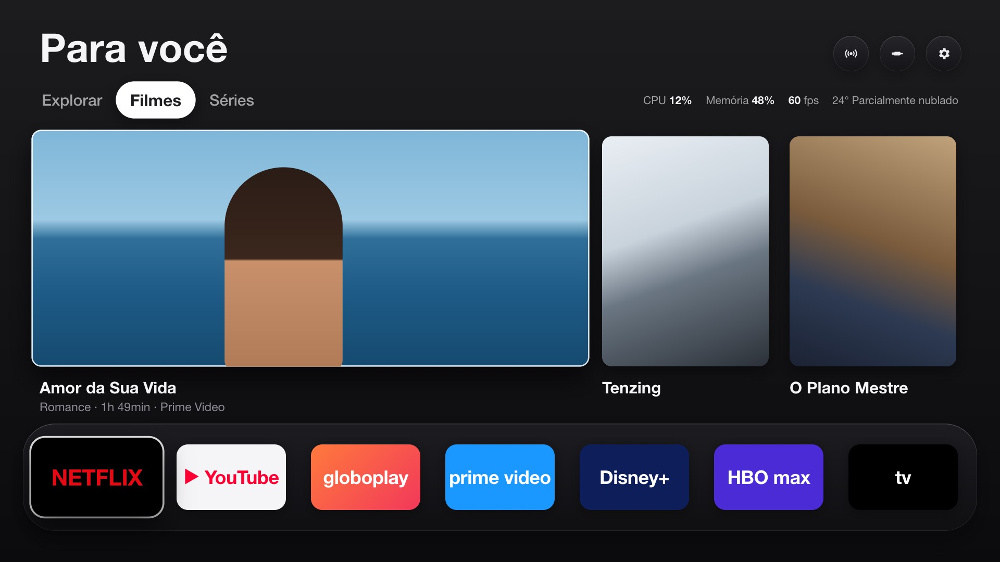
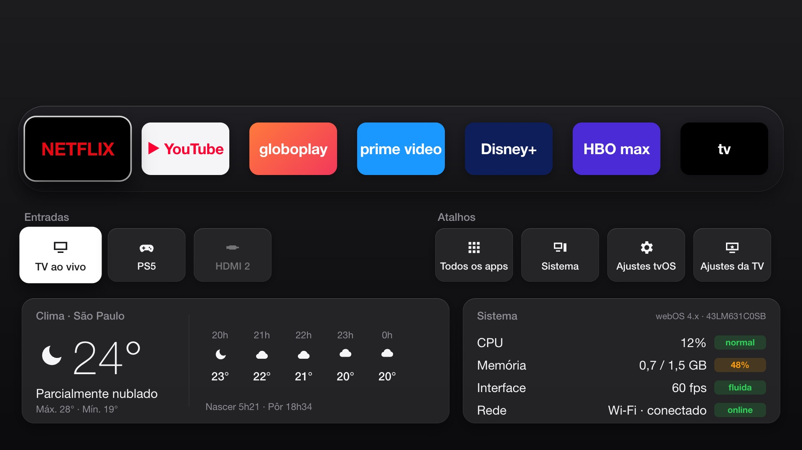

# tvOS

Home screen própria, rápida e sem anúncios para a TV **LG 43LM631C0SB** (43", webOS TV 4.x):
apps, destaques de filmes e séries, clima, entradas e o estado do sistema (CPU, memória, FPS).
Instalada como app pelo **Developer Mode da LG, sem root** — a home original continua lá e
desinstalar devolve tudo como era.

| Home | Gaveta (↓ na prateleira) |
|---|---|
|  |  |

> **Estado:** hoje o app instalado é o **esqueleto** (painel de CPU, memória e FPS). As telas acima
> são o alvo do MVP (`context/specs/01-home/`), em construção. O passo a passo abaixo já vale: as
> próximas versões instalam do mesmo jeito.

---

## Isso deixa a TV mais rápida?

**Deixa mais rápido o que é lento na home da LG — não a TV inteira.**

| Melhora | Não muda |
|---|---|
| A tela inicial: no lugar do portal da LG (banners, anúncios, recomendações carregando), uma tela leve (pacote de poucos KB, sem framework) | O **botão Home** do controle continua abrindo a home da LG (sem root não dá para trocá-lo) — use o atalho numérico (Parte 5) |
| Abrir apps e entradas: comando direto ao sistema (~100 ms), sem passar pelo portal | A velocidade **dentro** de Netflix, YouTube etc. (cada app tem o próprio peso) |
| Navegação a 60 fps, sem anúncio e sem telemetria | Ligar a TV e os menus de ajustes da LG |
| Você vê CPU, memória e FPS e sabe quando a TV está sobrecarregada | O hardware (CPU e memória são fixos) |

Referência: o FreeMyTvWebOS, que faz a mesma coisa, mede menos de 0,2 s para abrir contra 3,5–5 s da
home da LG (medido por eles no webOS 24; nesta TV vamos medir — veja "Medir antes e depois").

Para a **TV inteira** ficar mais leve, faça também os ajustes da Parte 6 (desligar Live Plus,
promoções e recomendações da LG). Eles reduzem o que roda em segundo plano o tempo todo.

---

## Tutorial: do zero até o tvOS na TV

Tempo: ~30 min na primeira vez. Você precisa de:
- a TV e um computador (macOS, Linux ou Windows) **na mesma rede Wi-Fi/cabo** (não use rede de convidados);
- o controle da TV;
- e-mail para criar duas contas grátis (LG Developer e TMDB).

### Parte 1 — Preparar o computador

1. Instale o **Node.js 20 ou mais novo** (https://nodejs.org → versão LTS). No macOS também dá
   `brew install node`. Confira: `node -v`.
2. Instale o **Git** (https://git-scm.com; no macOS já vem ou `xcode-select --install`).
3. Baixe o projeto e as dependências:
   ```bash
   git clone https://github.com/lurickardo/tvOS.git
   cd tvOS
   npm install
   ```

### Parte 2 — Chaves e informações (`.env`)

1. Crie o seu `.env` a partir do modelo:
   ```bash
   cp .env.example .env
   ```
2. Abra o `.env` num editor e preencha (cada campo está explicado no próprio `.env.example`):

| Variável | Obrigatória? | O que é | Onde conseguir |
|---|---|---|---|
| `TV_IP` | sim | IP da TV na rede | Parte 3, passo 6 |
| `TMDB_TOKEN` | para os destaques | "Token de Leitura da API" (v4) do TMDB, começa com `eyJ` | themoviedb.org → criar conta → Configurações → API → solicitar chave (tipo *Developer*, uso pessoal) → copiar **Token de Leitura da API** (não a "Chave da API" curta) |
| `CITY` | não (padrão: `São Vicente, São Paulo`) | cidade e estado; só o nome acha cidades de outros países. Troque para mudar o clima | — (clima pelo Open-Meteo, sem chave) |

> O `.env` nunca vai para o git. A **passphrase do Developer Mode não vai no `.env`**: você digita
> uma vez na Parte 4. Nunca envie o `.env` nem o `.ipk` gerado com ele para ninguém: o token vai
> dentro do pacote.

### Parte 3 — Preparar a TV (Developer Mode)

1. No computador, crie a conta grátis de desenvolvedor em https://webostv.developer.lge.com
   (*Sign In* → *Create Account*) e confirme o e-mail.
2. Na TV, abra a **LG Content Store** (Apps), procure **Developer Mode** e instale.
3. Abra o **Developer Mode** e entre com a conta do passo 1.
4. Ligue **Dev Mode Status** → a TV reinicia.
5. Abra o **Developer Mode** de novo e ligue **Key Server**.
6. Anote o **IP Address** mostrado e ponha em `TV_IP` no `.env`. Deixe a tela aberta: ela também
   mostra a **Passphrase** (6 caracteres) que você vai digitar na Parte 4.
7. (Recomendado) No roteador, reserve esse IP para a TV (reserva de DHCP), para ele não mudar.

### Parte 4 — Conectar e instalar

1. No computador, na pasta `tvOS`:
   ```bash
   npm run tv:setup
   ```
   Ele cadastra a TV (nome `tv`) com o `TV_IP`, pede a **passphrase** (digite a que aparece na TV) e
   mostra o modelo e a versão do webOS se a conexão funcionou.
2. Na TV, **desligue o Key Server** (com ele ligado, qualquer um na sua rede com a passphrase pode
   pegar a chave da TV).
3. Instale e abra o tvOS:
   ```bash
   npm run tv:install
   ```
   O tvOS abre na TV. O computador não precisa ficar ligado depois disso.

### Parte 5 — Usar no dia a dia

- **Atalho rápido:** com o tvOS aberto, **segure uma tecla numérica** do controle (ex.: `1`) e
  confirme para fixar o tvOS nela. Depois, segurar `1` de qualquer lugar abre o tvOS.
- Ele também aparece na lista de apps da TV como **tvOS**.
- No webOS 4 (sua TV) o atalho por tecla numérica pode se comportar diferente: se segurar o número
  não oferecer fixar o app, abra o tvOS pela lista de apps.
- No tvOS: setas e OK navegam; **Voltar** fecha a camada aberta ou sai do tvOS.

### Parte 6 — Deixar a TV inteira mais leve (ajustes da LG)

Ajustes do próprio webOS que tiram processamento e rede de segundo plano. Os nomes e caminhos podem
variar um pouco com a versão do firmware — use a busca dos ajustes se não achar.

| Ajuste | Onde (Configurações → Todas as configurações) | Faça |
|---|---|---|
| **Live Plus** (reconhecimento do que passa na tela) | Geral → Sistema → Configurações adicionais | Desligar |
| **Promoção da tela inicial** e **Recomendação de conteúdo** | Geral → Sistema → Configurações adicionais → Configurações da tela inicial | Desligar |
| **Acordos do usuário** (informações de visualização, publicidade) | Suporte → Privacidade e termos → Acordos do usuário | Desmarcar os opcionais |
| **Quick Start+** (liga mais rápido; gasta um pouco mais em standby) | Geral → Dispositivos → Configurações da TV | Ligar |
| Atualização de software | Suporte → Atualização de software | Manter em dia |
| Apps que você não usa | lista de apps → segurar OK → excluir | Remover |

De vez em quando, desligar a TV **da tomada por 1 minuto** limpa a memória acumulada.

### Parte 7 — Manutenção

- **Developer Mode expira** (o app mostra o tempo restante; cerca de 40 dias). Antes de acabar,
  abra o app **Developer Mode** na TV e aperte **EXTEND**. Se expirar, a TV remove o tvOS: renove e
  rode `npm run tv:install` de novo.
- **Atualizar o tvOS:** `git pull && npm install && npm run tv:install`.
- **IP da TV mudou:** atualize `TV_IP` no `.env`, ligue o Key Server e rode `npm run tv:setup`.
- **Desinstalar:** `npx ares-install -d tv --remove com.lurickardo.tvos` (ou pela lista de apps da TV).

### Medir antes e depois

1. **Home da LG:** com a TV ligada há alguns minutos, aperte Home e cronometre até conseguir
   navegar; depois cronometre Home → Netflix aberto.
2. **tvOS:** segure o atalho numérico e cronometre até a prateleira responder; depois tvOS → Netflix.
3. No painel do tvOS, veja FPS (alvo ≥ 55) e memória. No computador, `npm run tv:monitor` mostra
   CPU e memória do processo do tvOS a cada 2 s.

### Problemas comuns

| Sintoma | O que fazer |
|---|---|
| `tv:setup` não acha a TV | TV e computador na mesma rede? `TV_IP` certo? Developer Mode aberto com Key Server ON? |
| Passphrase recusada | Use a que está na tela **agora** (ela muda); Key Server precisa estar ON |
| `tv:install` dá timeout | TV desligada, IP mudou ou Developer Mode expirou (Parte 7) |
| tvOS sumiu da TV | Developer Mode expirou: EXTEND e `npm run tv:install` |
| CPU/memória mostram "—" | Normal no computador; na TV, avise (pode ser limitação do Developer Mode) |
| Tela branca na TV | `npm run tv:inspect` abre o console do app para ver o erro |

---

## Desenvolvimento

```bash
npm run dev            # http://127.0.0.1:8000 (navegador em 1920×1080, só teclado)
npm run check          # typecheck + lint de skills + encoding
npm run tv:package     # gera o .ipk em dist/ sem a TV
npm run tv:inspect     # DevTools do app rodando na TV
npm run tv:monitor     # CPU/memória do tvOS na TV
```

Para quem desenvolve com Claude Code: `CLAUDE.md` é a porta de entrada; decisões em
`context/adr/`, specs em `context/specs/`.

## Estrutura

```
app/          casca HTML/CSS, appinfo.json, ícones
src/          código TypeScript (platform/, features/, config.ts)
service/      JS service do webOS (métricas do sistema)
scripts/      build (esbuild), tv-setup e checks
context/      regras, ADRs e specs (mockups da home em specs/01-home/)
.claude/      skills para o Claude Code
```

## Créditos

Inspirado em [FreeMyTvWebOS](https://github.com/danielthejoker18/FreeMyTvWebOS) e
[free-my-tv](https://github.com/simbasjungles/free-my-tv) (MIT) — veja `THIRD_PARTY_NOTICES.md`.
Dados de filmes e séries: [TMDB](https://www.themoviedb.org/) (este produto usa a API do TMDB, mas
não é endossado nem certificado pelo TMDB). Clima: [Open-Meteo](https://open-meteo.com/).
